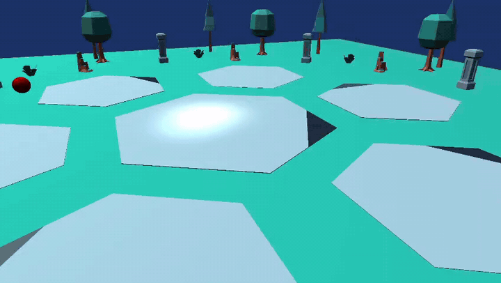

# Battle Mage

> 🚧 **Work in progress.** This README is a quick summary; it will grow as the project moves forward.

A 3D magic combat simulator written in C++ with OpenGL 3.3. Two AI-controlled mages fight on their own: the combat is first simulated without graphics and then replayed in a 3D arena.

Team project (6 people) for the **Visualització Gràfica Interactiva (VGI)** course at UAB.

## Current status

- Fixed-timestep, reproducible combat simulation, decoupled from rendering.
- Mage AI built as a state machine: wait, chase, attack and flee.
- Spells with mana, range and cooldown, plus hit detection.
- 3D arena with lighting, shadows, textures and `.obj` models.
- Phase 0 demo finished (31 Oct 2026).

## Running it

64-bit Windows 10/11 with Visual Studio (C++ desktop workload):

1. `git clone https://github.com/CatCodeMage/batleMage.git`
2. Open `posibleProyecto.slnx`.
3. Select **x64** and **Debug**, then run.

The libraries (GLFW, GLEW, GLM, SOIL2, tinyobjloader, nlohmann/json) are included in the repo. More details in [`docs/`](docs/) (in Spanish).
